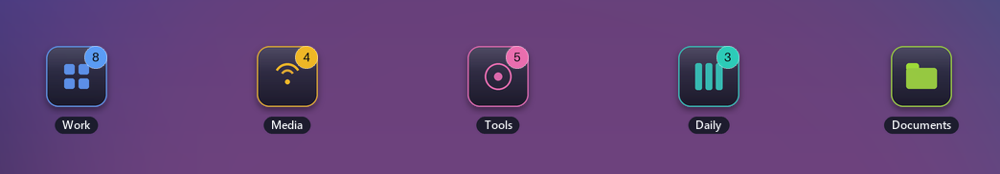
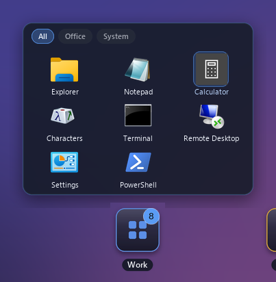
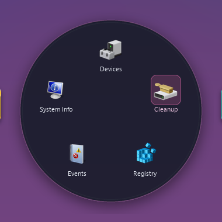
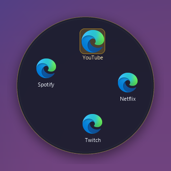
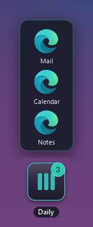
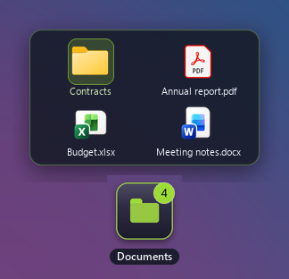
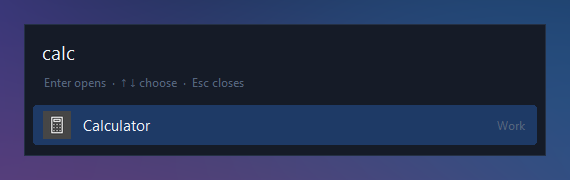
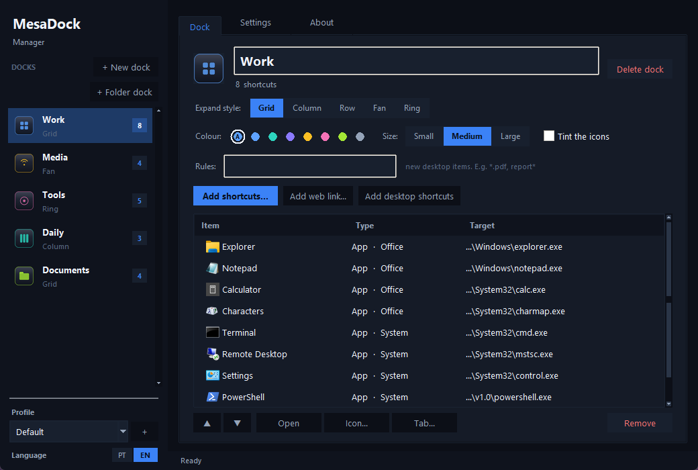

# MesaDock

[Português](README.md) · **English**

**Organize your Windows desktop into docks: one icon per group of shortcuts, opening into a panel.**

MesaDock puts one icon on your desktop for each group of shortcuts. Hover over it or click it and it opens into a Grid, Column, Row, Fan or Ring panel with that group's programs, files, folders and websites.

Built with Python, Tkinter and Pillow. No account, no telemetry, and no cloud: everything stays on your computer.

[**Download the latest version**](https://github.com/santificado13/mesadock/releases/latest)



| Grid with tabs | Ring | Fan | Column |
| --- | --- | --- | --- |
|  |  |  |  |

| Folder dock | Quick search |
| --- | --- |
|  |  |



## Features

**Organization**
- **Five panel styles:** Grid, Column, Row, Fan and Ring.
- **Folder dock:** a dock that shows a live folder, such as Downloads, a project or a OneDrive folder. It only reads the folder and never modifies it.
- **Automatic rules:** each dock can have rules like `*.pdf, relatorio*`. New items that appear on the desktop with a matching name go into the dock on their own. Downloads still in progress are ignored until they finish.
- **Tabs inside the panel:** "All | Office | System", in the Grid, Column and Row styles.
- **Profiles:** separate sets of docks (Work, Home, Presentation), switched from the tray menu or with Ctrl+Alt+K.

**Quick access**
- **Quick search:** Ctrl+Alt+B opens a search box. Type part of a name, with or without accents, and press Enter to open any item from any dock.
- **Bring to front:** Ctrl+Alt+F shows the docks above open windows.
- **Hide all:** Ctrl+Alt+H, or double-click the wallpaper, hides and shows all docks.
- **Drag and drop:** drop files, folders and shortcuts directly onto a dock.

**Visual**
- **True transparency:** docks and panels with smooth borders and a soft shadow over any wallpaper.
- **Color, size and icon tint per dock,** and a single opacity for docks and panels.
- **Custom icon per item:** "Change icon..." on right-click. Chrome and Edge web apps keep their own icon.
- **Sharp at any scale:** DPI-aware per monitor (100 %, 125 %, 150 % and different monitors).

**Shortcut safety**
- **Copy mode (default):** the original shortcut stays on the desktop.
- **Move mode (optional):** the original leaves the desktop and returns when you remove it from the dock.
- **Backup:** backup and restore buttons in the About tab, plus an automatic daily backup (keeps the last 7).
- **Starts with Windows** (optional) and stays in the tray, near the clock.
- **Portuguese and English,** switched in the Manager.

## Installation

### Download the ready-made program (recommended)

1. Download the `MesaDock-<version>.zip` from the [Releases](https://github.com/santificado13/mesadock/releases/latest) page.
2. Extract and run `MesaDock.exe`. Python is not needed.

On first run Windows may show **"Windows protected your PC"**, because the exe is not digitally signed yet. Click **More info** and then **Run anyway**.

To update, replace `MesaDock.exe` with the new one: your docks and shortcuts are kept.

### Run from source

```powershell
git clone https://github.com/santificado13/mesadock.git
cd mesadock
pip install -r requirements.txt
python -m mesadock
```

### Build the .exe

```powershell
powershell -ExecutionPolicy Bypass -File build.ps1
```

The script creates an isolated Python environment (`.venv-build`), runs the tests and then generates `dist\MesaDock.exe` and `dist\MesaDock-<version>.zip`.

## Requirements

| Item | Requirement |
| --- | --- |
| System | Windows 10 or Windows 11, 64-bit |
| Python (only for running from source) | 3.10 or newer; tests run on 3.12 and 3.14 |
| Packages | `pillow`, `pydantic`, `pylnk3`; `pytest` for the tests |

Linux and macOS are not supported: the desktop integration is Windows-specific.

## Getting started

1. On first run the **Manager** opens automatically. Click **+ New dock**, or **+ Folder dock** to mirror a folder.
2. Drag shortcuts from the desktop onto the dock icon, or use **Add shortcuts...** and **Add web link...**.
3. Click the dock icon (or hover, if you chose that option in Settings): the panel opens. Click an item to open it.
4. Right-click a dock to change its style or add items, and right-click an item to change its icon, move it to a tab, or remove it.
5. Right-click the tray icon to switch profile, search, hide the docks or exit.

## Keyboard shortcuts

| Shortcut | Action |
| --- | --- |
| `Ctrl+Shift+M` | Open the Manager (from anywhere) |
| `Ctrl+Alt+B` | Quick search |
| `Ctrl+Alt+F` | Bring the docks to the front of windows, or send them back |
| `Ctrl+Alt+H` | Hide or show all docks |
| `Ctrl+Alt+K` | Next profile |
| `Ctrl+Shift+D` | Create a dock (with a MesaDock window focused) |
| `Esc` | Close panels, the search and the Manager |
| `Ctrl+A` | Add files to the selected dock (in the Manager) |
| `Delete` | Remove the selected item (in the Manager) |

The `Ctrl+Alt` shortcuts and `Ctrl+Shift+M` work in any program. If another program already uses the combination, MesaDock logs it and the option remains available in the tray menu.

## Command line

```powershell
python -m mesadock --version          # shows the version
python -m mesadock --manager          # starts with the Manager open
python -m mesadock --portable D:\USB  # stores all data in a folder
python -m mesadock --no-desktop       # does not pin docks to the desktop

python -m mesadock doctor             # environment diagnostics (also --json)
python -m mesadock list               # lists the docks and items of the active profile
python -m mesadock add PATH --dock "Work"   # adds a file, folder or URL
python -m mesadock restore            # puts archived shortcuts of every profile back on the desktop
python -m mesadock autostart --off    # disables Windows autostart
python -m mesadock export backup.zip  # exports docks, items and icons
python -m mesadock import backup.zip  # imports from an export
```

## Where your data is stored

```
%APPDATA%\MesaDock\
├── store.db              profiles, docks and settings (SQLite)
├── items\<dock>\         copies of the shortcuts for each dock
├── archived\<profile>\   originals taken from the desktop (move mode)
├── backups\              automatic backups and the state before a restore
├── icons\                icon cache
└── logs\                 mesadock.log and up to 3 older copies (~4 MB at most)
```

The `MESADOCK_HOME` variable changes the data folder, as does `--portable FOLDER`. `MESADOCK_DEBUG=1` also logs detailed events.

### Uninstall without losing anything

In the Manager, **About** tab, click **Restore all archived shortcuts** to put everything that was moved back on the desktop. After that you can delete the `%APPDATA%\MesaDock` folder and the exe. From the command line, the equivalent is `python -m mesadock restore`.

## Privacy

MesaDock **does not make any network requests**: it has no account, statistics, error reporting or update checking. Your shortcuts, icons and settings never leave the computer.

## Development

```powershell
python -m pytest -q        # tests
python -m ruff check mesadock tests tools launcher.py   # lint
python tools/capture_screens.py --lang en               # regenerate the screenshots for this page
```

The tests cover models, the five layouts, storage, archiving, rules, tabs, backup and restore, search, icon extraction and the real Tk interface. They never touch the real desktop: they run with `MESADOCK_NO_DESKTOP=1` and a temporary data folder. The GitHub CI runs lint and tests on Windows with Python 3.12 and 3.14 on each push, and builds the exe for each release.

The screenshots on this page are generated by `tools/capture_screens.py`, which builds an example profile over a custom background; no screenshot comes from a real desktop.

### Structure

```
mesadock/
├── mesadock/
│   ├── core/       logic without UI: models, layout, storage, archiving,
│   │               folder dock, rules, search, backup, icons, translations
│   ├── win32/      Windows calls: desktop, monitors, DPI, shell,
│   │               drag and drop, transparent windows
│   ├── ui/         Tkinter UI: app, dock, panel, Manager, search, tray
│   ├── cli.py      doctor, list, add, restore, autostart, export, import
│   └── app_boot.py single instance, DPI, log and error handling
├── tests/          automated tests
├── tools/          screenshot capture and UI reference verification
├── docs/           screenshots and the vector icon design
└── build.ps1       builds the exe with PyInstaller
```

The changelog is in [CHANGELOG](CHANGELOG.md).

## License

MIT: see [LICENSE](LICENSE).

MesaDock is an independent project. It is not affiliated with, endorsed by, or derived from any commercial desktop organizer, and it includes no third-party code, art, or text.
