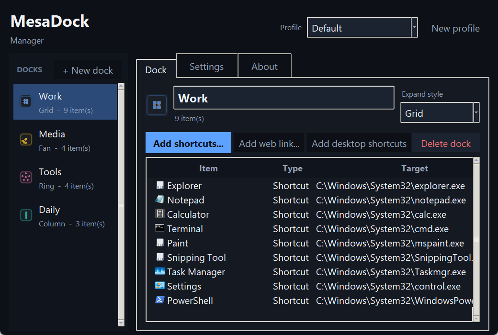
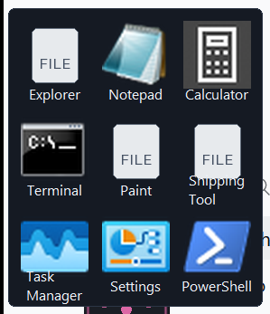
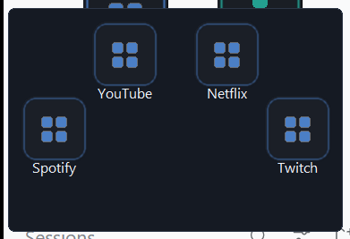
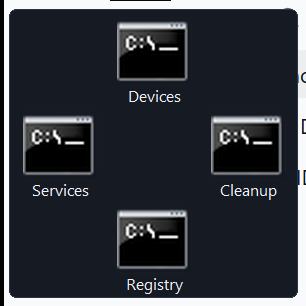

# MesaDock

**Turn your desktop shortcuts into clean, single-icon docks.**

MesaDock sits on your Windows desktop, shows one small icon per folder of
shortcuts, and expands that icon into a polished panel (grid, column, row, fan
or a 360° ring) the moment you hover over it or click it.

Built with Python 3.12 + Tkinter + Pillow. No account, no telemetry, no cloud —
everything lives in a single JSON file on your PC.

---



| Grid panel | Fan panel | Ring panel |
| --- | --- | --- |
|  |  |  |

Screenshots are produced by `tools/capture_screens.py`, which builds a temporary
profile with sample docks and grabs the real windows.

## Features

- **Five panel shapes** — Grid, Column, Row, Fan and a 360° Ring, each drawn on
  a single anti-aliased canvas with a soft rounded card.
- **Lives on the desktop** — docks are pinned to the desktop layer, so they sit
  behind your open windows, exactly like native icons. New docks snap to a free
  cell of the live desktop icon grid, so they never land on top of an icon.
- **Hover or click to open** — pick your trigger and a hover delay in the
  Manager; panels fade in and close themselves when the pointer leaves.
- **Archive or copy on add** — in Archive mode a shortcut dragged onto a dock is
  *moved away* from the desktop into MesaDock's storage and put back the moment
  you remove it or uninstall. Copy mode (the default) leaves the original where
  it is and simply links to it.
- **Profiles** — separate dock sets for Work, Home or a screen-share profile,
  switchable from the tray menu in one click.
- **Manager window** — a dark, three-tab control centre: dock and item editing,
  all settings, and an About tab with your data folder and a one-click
  "restore everything" safety valve.
- **Real Windows icons** — shell icon extraction with a PNG cache, plus original
  vector-ish dock artwork generated for every panel style.
- **Per-Monitor V2 DPI aware** — crisp on 100 %, 125 %, 150 % and mixed setups;
  docks re-place themselves when a display is added, removed or rescaled.
- **Tray resident and start-with-Windows** — runs quietly in the notification
  area; autostart is a single registry value and can be toggled off any time.
- **Drag & drop** — drop files, folders and shortcuts straight onto a dock.

## Requirements

| Item | Requirement |
| --- | --- |
| OS | Windows 10 (1809+) or Windows 11 |
| Python | 3.10 or newer (3.12 recommended) |
| Packages | `pillow`, plus `pytest` for the test suite |
| Shell | Explorer with the classic desktop icon list |

Linux and macOS are not supported: the desktop integration is Win32 specific.

## Install

```powershell
git clone https://github.com/santificado13/mesadock.git mesadock
cd mesadock
pip install -r requirements.txt
python -m mesadock
```

The first launch creates `%APPDATA%\MesaDock` and opens the Manager so you can
add your first dock.

### Download the ready-made .exe

No Python needed: grab **MesaDock.exe** (plus `MesaDock.ico`) from the
[Releases](https://github.com/santificado13/mesadock/releases) page, install it
to `%LOCALAPPDATA%\Programs\MesaDock` and double-click it.

### Run it like a normal app

You do not need the command line once it is built. Double-click `MesaDock.exe`
(or the desktop shortcut) and the app starts in the tray, with its docks on the
desktop. A **first run opens the Manager**, because a brand new profile has no
docks yet and an empty tray would look like nothing happened.

Double-clicking again while it is already running brings the Manager back to the
front instead of starting a second copy: the second process hands the request to
the running one through the tray window and a small handshake file, so it works
even when the shell has no tray. Note that a `--onefile` PyInstaller build must
not live inside a folder whose ACL denies creation to unknown accounts (the
bundled loader unpacks into a temp folder); install it to
`%LOCALAPPDATA%\Programs\MesaDock` as the installer below does.

### Build a standalone .exe

```powershell
pip install pyinstaller
powershell -ExecutionPolicy Bypass -File build.ps1
```

The build script produces `dist\MesaDock.exe` (single file, windowed, no
console) plus `MesaDock.ico`. For a folder build instead, change `--onefile` to
`--onedir` in `build.ps1`.

## Quick start

1. **Manager → Dock tab → New dock.** Pick a name and a panel style.
2. Drag shortcuts from your desktop onto the dock icon, or use
   **Add files…** / **Add link…**.
3. Hover the dock icon: the panel opens. Click an item to launch it.
4. Right-click a dock for quick actions (rename, style, icon, remove).
5. Right-click the tray icon to switch profile or quit.

## Keyboard shortcuts

| Shortcut | Action |
| --- | --- |
| `Ctrl+Shift+M` | Open the Manager |
| `Ctrl+Shift+D` | Create a new dock |
| `Esc` | Close panels / cancel a dialog |
| `Ctrl+A` | Add files to the selected dock (Manager) |
| `Delete` | Remove the selected item (Manager) |

## Command line

```powershell
python -m mesadock --version          # print the version
python -m mesadock --manager          # start with the Manager open
python -m mesadock --portable D:\USB  # keep all data next to the exe
python -m mesadock --no-desktop       # do not touch the desktop layer

python -m mesadock doctor             # check the environment (also --json)
python -m mesadock list               # list profiles, docks and items
python -m mesadock add PATH --dock "Work"   # add a file/folder/URL to a dock
python -m mesadock restore            # put archived shortcuts back
python -m mesadock autostart --off    # disable start with Windows
python -m mesadock export backup.zip  # export every dock, item and icon
python -m mesadock import backup.zip  # restore from an export
```

## Where your data lives

```
%APPDATA%\MesaDock\
├── store.json              profiles + settings (atomic writes, one .bak)
├── archived/<profile>/     shortcuts moved off the desktop
├── items/<dock-id>/        MesaDock's copies of docked files
├── icons/                  extracted and generated PNGs
└── logs/mesadock.log       rotating log
```

Set `MESADOCK_HOME` to use a different folder, or launch with `--portable DIR`.

### Removing MesaDock without losing anything

Manager → **About → Restore archived shortcuts** moves every archived item back
to the desktop first. Only then delete the `%APPDATA%\MesaDock` folder. If
MesaDock ever starts in a bad state, the same button is reachable from the CLI
with `python -m mesadock restore`.

## Privacy

MesaDock makes **no network requests**. There is no account, no analytics, no
crash upload and no update ping. Your shortcuts, icons and settings never leave
the machine. The tray icon, the Manager and the panels are the entire UI.

## Tests

```powershell
$env:PYTHONPATH="."
python -m pytest tests -q
```

The suite covers the models, all five layouts, the store (atomic save, backup
recovery, profiles), the archiver (move vs copy, restore, URL files), icon
extraction from real system executables, the shell helpers and the boot path
(stale-mutex takeover, second-launch handoff, first-run visibility). Tests never
touch a real desktop: they run with `MESADOCK_NO_DESKTOP=1` and a temporary data
folder.

## Project layout

```
mesadock/
├── mesadock/
│   ├── core/      pure, headless logic (models, layout, store, archive, icons)
│   ├── win32/     ctypes bindings: desktop, monitors, DPI, shell, drag & drop
│   ├── ui/        Tkinter layer: app, dockwindow, panel, manager, tray, theme
│   ├── cli.py     doctor / list / add / restore / autostart / export / import
│   └── app_boot.py  single instance, DPI, logging, crash handling
├── tests/         128 tests: headless suites + real-Tk smoke tests
├── tools/         screenshot capture and a static UI reference linter
├── docs/          screenshots
└── build.ps1      PyInstaller build
```

## License

MIT — see [LICENSE](LICENSE).

MesaDock is an independent project. It is not affiliated with, endorsed by, or
derived from DeskRipple or any other commercial desktop organiser; no third-party
code, artwork or copy is included.
