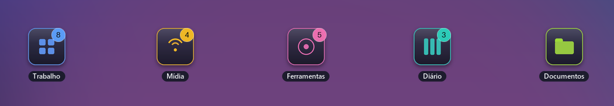
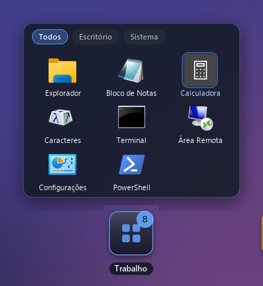
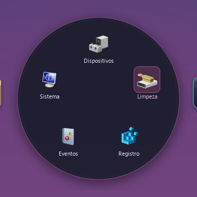
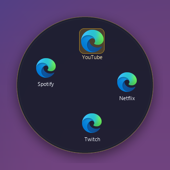
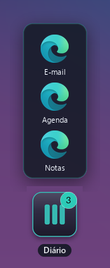
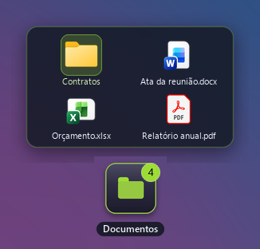
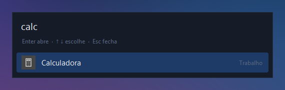
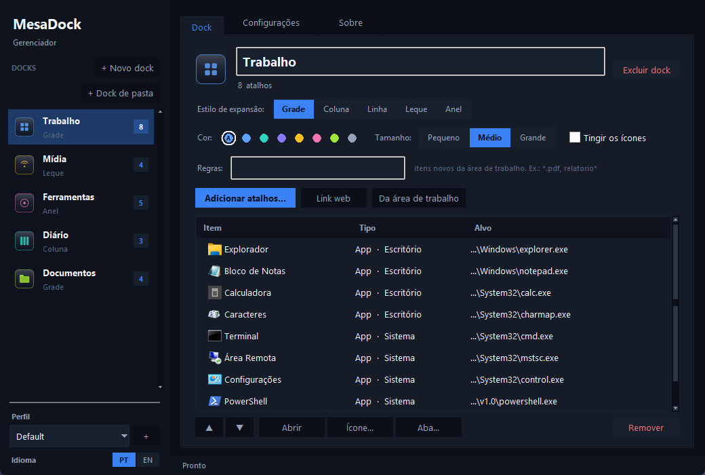

# MesaDock

**Português** · [English](README.en.md)

**Organize a área de trabalho do Windows em docks: um ícone por grupo de atalhos, que se abre num painel.**

O MesaDock coloca na sua área de trabalho um ícone para cada grupo de atalhos. Ao passar o mouse ou clicar, o ícone se abre num painel em grade, coluna, linha, leque ou anel, com os programas, arquivos, pastas e sites daquele grupo.

Feito em Python com Tkinter e Pillow. Sem conta, sem telemetria e sem nuvem: tudo fica no seu computador.

[**Baixar a versão mais recente**](https://github.com/santificado13/mesadock/releases/latest)



| Grade com abas | Anel | Leque | Coluna |
| --- | --- | --- | --- |
|  |  |  |  |

| Dock de pasta | Busca rápida |
| --- | --- |
|  |  |



## Recursos

**Organização**
- **Cinco formatos de painel:** Grade, Coluna, Linha, Leque e Anel.
- **Dock de pasta:** uma dock que mostra uma pasta ao vivo, como Downloads, um projeto ou uma pasta do OneDrive. Ela só lê a pasta e nunca a altera.
- **Regras automáticas:** cada dock pode ter regras como `*.pdf, relatorio*`. Itens novos que aparecem na área de trabalho com um nome que combina entram sozinhos na dock. Downloads em andamento são ignorados até terminarem.
- **Abas dentro do painel:** "Todos | Escritório | Sistema", nos estilos Grade, Coluna e Linha.
- **Perfis:** conjuntos separados de docks (Trabalho, Casa, Apresentação), trocados pelo menu da bandeja ou com Ctrl+Alt+K.

**Acesso rápido**
- **Busca rápida:** Ctrl+Alt+B abre uma caixa de busca. Digite parte do nome, com ou sem acento, e aperte Enter para abrir qualquer item de qualquer dock.
- **Trazer para a frente:** Ctrl+Alt+F mostra as docks por cima das janelas abertas.
- **Ocultar tudo:** Ctrl+Alt+H, ou duplo clique no papel de parede, esconde e mostra todas as docks.
- **Arrastar e soltar:** solte arquivos, pastas e atalhos direto numa dock.

**Visual**
- **Transparência real:** docks e painéis com bordas lisas e sombra suave sobre qualquer papel de parede.
- **Cor, tamanho e tingimento por dock,** e uma opacidade única para docks e painéis.
- **Ícone próprio por item:** "Trocar ícone..." no clique direito. Apps da web do Chrome e do Edge mantêm o próprio ícone.
- **Nítido em qualquer escala:** compatível com DPI por monitor (100 %, 125 %, 150 % e monitores diferentes).

**Segurança dos seus atalhos**
- **Modo cópia (padrão):** o atalho original continua na área de trabalho.
- **Modo mover (opcional):** o original sai da área de trabalho e volta para lá quando você o remove da dock.
- **Backup:** botões de backup e de restauração na aba Sobre, mais um backup automático por dia (ficam os 7 últimos).
- **Inicia com o Windows** (opcional) e fica na bandeja, perto do relógio.
- **Português e inglês,** trocados no Gerenciador.

## Instalação

### Baixar o programa pronto (recomendado)

1. Baixe o `MesaDock-<versão>.zip` na página de [Releases](https://github.com/santificado13/mesadock/releases/latest).
2. Extraia e rode o `MesaDock.exe`. Não precisa instalar o Python.

Na primeira execução o Windows pode mostrar **"O Windows protegeu o computador"**, porque o exe ainda não é assinado digitalmente. Clique em **Mais informações** e depois em **Executar assim mesmo**.

Para atualizar, troque o `MesaDock.exe` pelo novo: as docks e os atalhos continuam.

### Rodar a partir do código

```powershell
git clone https://github.com/santificado13/mesadock.git
cd mesadock
pip install -r requirements.txt
python -m mesadock
```

### Gerar o .exe

```powershell
powershell -ExecutionPolicy Bypass -File build.ps1
```

O script cria um ambiente Python isolado (`.venv-build`), roda os testes e só então gera `dist\MesaDock.exe` e `dist\MesaDock-<versão>.zip`.

## Requisitos

| Item | Requisito |
| --- | --- |
| Sistema | Windows 10 ou Windows 11, 64 bits |
| Python (só para rodar do código) | 3.10 ou mais novo; os testes rodam em 3.12 e 3.14 |
| Pacotes | `pillow`, `pydantic`, `pylnk3`; `pytest` para os testes |

Linux e macOS não são suportados: a integração com a área de trabalho é específica do Windows.

## Primeiros passos

1. Na primeira execução o **Gerenciador** abre sozinho. Clique em **+ Novo dock**, ou em **+ Dock de pasta** para espelhar uma pasta.
2. Arraste atalhos da área de trabalho para o ícone da dock, ou use **Adicionar atalhos...** e **Link web**.
3. Clique no ícone da dock (ou passe o mouse, se escolher essa opção nas Configurações): o painel se abre. Clique num item para abri-lo.
4. Clique com o botão direito numa dock para trocar o estilo ou adicionar itens, e num item para trocar o ícone, mover para uma aba ou removê-lo.
5. Clique com o botão direito no ícone da bandeja para trocar de perfil, buscar, ocultar as docks ou sair.

## Atalhos de teclado

| Atalho | Ação |
| --- | --- |
| `Ctrl+Shift+M` | Abrir o Gerenciador (de qualquer lugar) |
| `Ctrl+Alt+B` | Busca rápida |
| `Ctrl+Alt+F` | Trazer as docks para a frente das janelas, ou mandá-las de volta |
| `Ctrl+Alt+H` | Ocultar ou mostrar todas as docks |
| `Ctrl+Alt+K` | Próximo perfil |
| `Ctrl+Shift+D` | Criar uma dock (com uma janela do MesaDock em foco) |
| `Esc` | Fechar painéis, a busca e o Gerenciador |
| `Ctrl+A` | Adicionar arquivos à dock selecionada (no Gerenciador) |
| `Delete` | Remover o item selecionado (no Gerenciador) |

Os atalhos com `Ctrl+Alt` e o `Ctrl+Shift+M` funcionam em qualquer programa. Se outro programa já usar a combinação, o MesaDock anota isso no log e a opção continua disponível no menu da bandeja.

## Linha de comando

```powershell
python -m mesadock --version          # mostra a versão
python -m mesadock --manager          # inicia com o Gerenciador aberto
python -m mesadock --portable D:\USB  # guarda todos os dados numa pasta
python -m mesadock --no-desktop       # não prende as docks à área de trabalho

python -m mesadock doctor             # diagnóstico do ambiente (também --json)
python -m mesadock list               # lista as docks e os itens do perfil ativo
python -m mesadock add CAMINHO --dock "Trabalho"   # adiciona arquivo, pasta ou URL
python -m mesadock restore            # devolve à área de trabalho os atalhos arquivados de todos os perfis
python -m mesadock autostart --off    # desliga a inicialização com o Windows
python -m mesadock export backup.zip  # exporta docks, itens e ícones
python -m mesadock import backup.zip  # importa de uma exportação
```

## Onde ficam os seus dados

```
%APPDATA%\MesaDock\
├── store.db              perfis, docks e configurações (SQLite)
├── items\<dock>\         cópias dos atalhos de cada dock
├── archived\<perfil>\    originais tirados da área de trabalho (modo mover)
├── backups\              backups automáticos e o estado anterior a uma restauração
├── icons\                cache de ícones
└── logs\                 mesadock.log e até 3 cópias antigas (no máximo ~4 MB)
```

A variável `MESADOCK_HOME` muda a pasta de dados, assim como `--portable PASTA`. `MESADOCK_DEBUG=1` grava no log também os eventos detalhados.

### Desinstalar sem perder nada

No Gerenciador, aba **Sobre**, clique em **Restaurar todos os atalhos arquivados** para devolver à área de trabalho tudo o que foi movido. Depois disso pode apagar a pasta `%APPDATA%\MesaDock` e o exe. Pela linha de comando, o equivalente é `python -m mesadock restore`.

## Privacidade

O MesaDock **não faz nenhuma requisição de rede**: não tem conta, estatísticas, envio de erros nem verificação de atualizações. Seus atalhos, ícones e configurações nunca saem do computador.

## Desenvolvimento

```powershell
python -m pytest -q        # testes
python -m ruff check mesadock tests tools launcher.py   # lint
python tools/capture_screens.py --lang pt               # refaz as fotos desta página
```

Os testes cobrem modelos, os cinco layouts, o armazenamento, o arquivamento, as regras, as abas, o backup e a restauração, a busca, a extração de ícones e a interface real em Tk. Eles nunca mexem na área de trabalho de verdade: rodam com `MESADOCK_NO_DESKTOP=1` e uma pasta de dados temporária. O CI do GitHub roda o lint e os testes no Windows com Python 3.12 e 3.14 a cada envio, e gera o exe a cada versão.

As fotos desta página são geradas por `tools/capture_screens.py`, que monta um perfil de exemplo sobre um fundo próprio; nenhuma foto vem de uma área de trabalho real.

### Estrutura

```
mesadock/
├── mesadock/
│   ├── core/       lógica sem interface: modelos, layout, armazenamento, arquivamento,
│   │               dock de pasta, regras, busca, backup, ícones, traduções
│   ├── win32/      chamadas ao Windows: área de trabalho, monitores, DPI, shell,
│   │               arrastar e soltar, janelas com transparência
│   ├── ui/         interface Tkinter: app, dock, painel, Gerenciador, busca, bandeja
│   ├── cli.py      doctor, list, add, restore, autostart, export, import
│   └── app_boot.py instância única, DPI, log e tratamento de erros
├── tests/          testes automáticos
├── tools/          captura das fotos e verificação de referências da interface
├── docs/           fotos e o desenho vetorial do ícone
└── build.ps1       gera o exe com PyInstaller
```

O histórico de mudanças está no [CHANGELOG](CHANGELOG.md).

## Licença

MIT: veja [LICENSE](LICENSE).

O MesaDock é um projeto independente. Não é afiliado, endossado nem derivado de nenhum organizador de área de trabalho comercial, e não inclui código, arte ou textos de terceiros.
